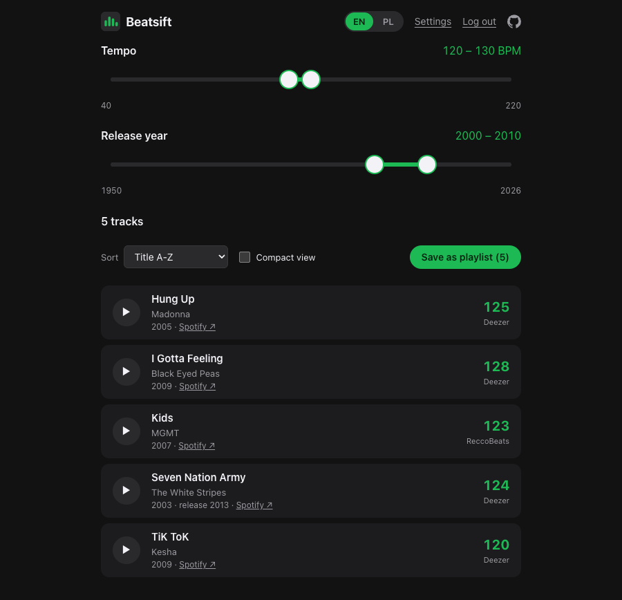

# Beatsift

<!-- prettier-ignore-start -->

<!-- prettier-ignore-end -->

🔨 A web app that connects to Spotify, pulls your Liked Songs and the playlists
you pick, and lets you sift out the tracks at a given tempo and from a given
range of years. Typical use:
"tracks at 120-130 BPM from 2000-2010". You save the result as a new playlist
on your account.

> Give a ⭐️ if this project helped you!

## Live 🌍

The app runs at **[piecioshka.github.io/spotify-beatsift](https://piecioshka.github.io/spotify-beatsift/)**.
It is a Spotify app in development mode, so only accounts added to its user
list can log in. To use it with your own account, run it yourself with your
own Client ID (see [CONTRIBUTING.md](CONTRIBUTING.md)).

## Features ✨

- 🎚️ Two range sliders: tempo in BPM and release year, both remembered between visits
- 🥁 Tempo from Deezer (matched by ISRC) with ReccoBeats as a fallback, because Spotify shut its BPM API down
- 📅 Release year corrected with Deezer data, so a 2003 song from a 2015 compilation still counts as 2003
- 🗂️ Sources picked once after login: Liked Songs plus any of your own or collaborative playlists, with a select-all switch _(changeable in settings)_
- 💾 Tracks cached in IndexedDB; Liked Songs sync incrementally and stop at the first known track, playlists get a full pass
- 🔀 Sorting by title, artist, BPM, year or date added _(the same order goes into the playlist)_
- 📋 Compact view that fits each track on one line
- ▶️ In-page playback through the Spotify embed, with automatic advance to the next result
- 💿 One click exports the result as a private playlist on your account
- 🌍 English and Polish interface, picked from the browser language and switchable in the header
- 🌗 Dark and light theme, following the system by default and switchable in the header
- 🍪 No cookies and no tracking; a consent bar explains what lands in the browser
- 🔐 Login with Authorization Code + PKCE, no client secret and no backend

## Limitations

- The Deezer API terms allow non-commercial use only.
- The first sync of a few thousand Liked Songs takes a few minutes, because
  Deezer accepts about 50 requests per 5 seconds. Results stay in the
  database for good, so it is a one-time cost. The tab has to stay open.
- Tracks without an ISRC and local files added to the library are skipped.
- A track without a known tempo or without a release year does not show up
  in the results. If it is not known whether it matches, it does not go into
  the playlist.
- JSONP means a script from Deezer's domain runs inside the page. For a
  personal tool that is acceptable; for a public deployment a proxy of your
  own is the better choice.

## 🤝 Contributing

Contributions, issues and feature requests are welcome!  Setup, scripts, deployment and internals are described in [CONTRIBUTING.md](CONTRIBUTING.md). Feel free to check [issues page](https://github.com/piecioshka/spotify-beatsift/issues/).

## License

[The MIT License](https://piecioshka.mit-license.org) @ 2026
